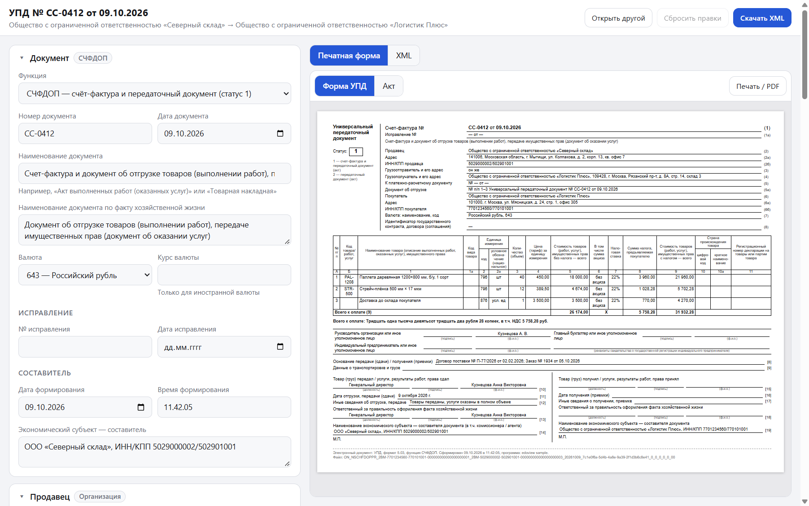
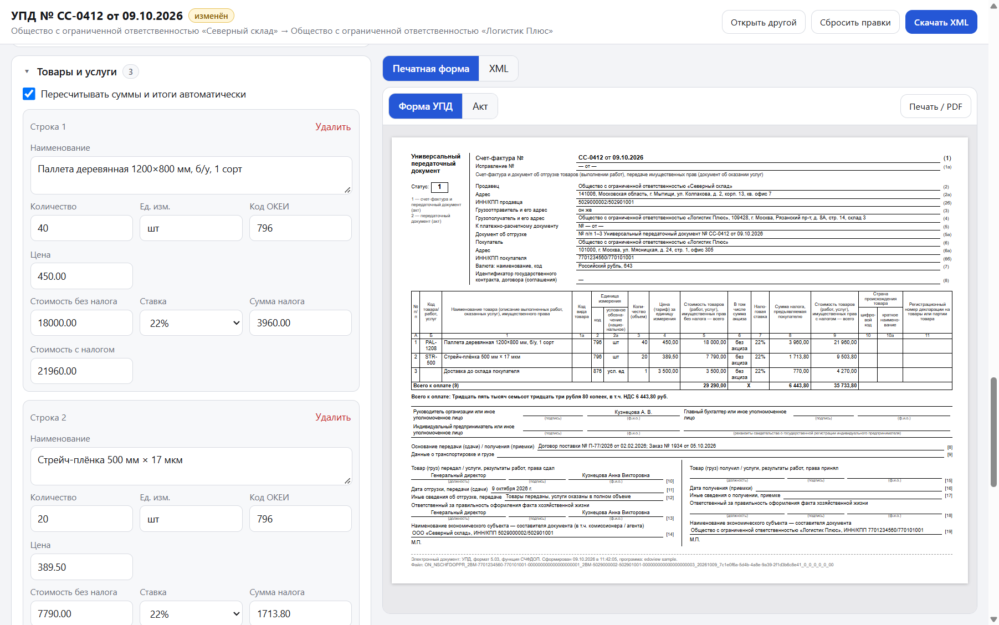
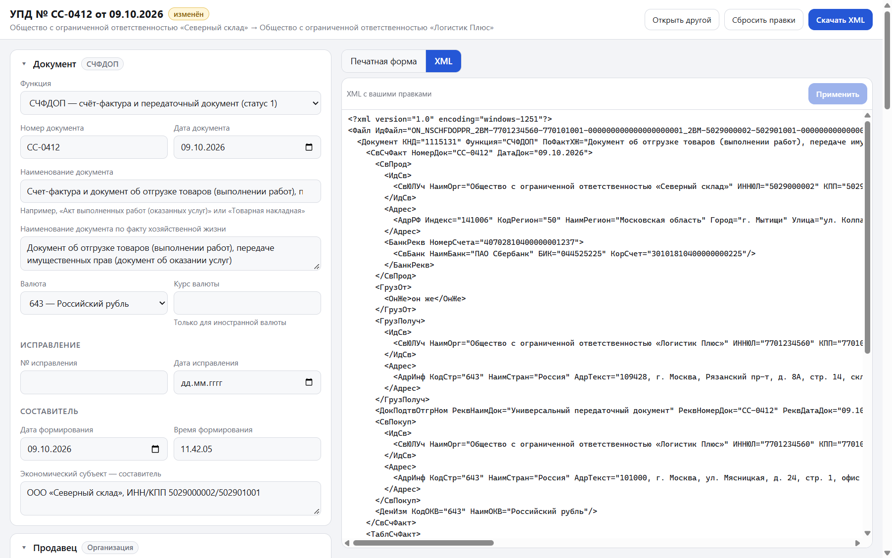
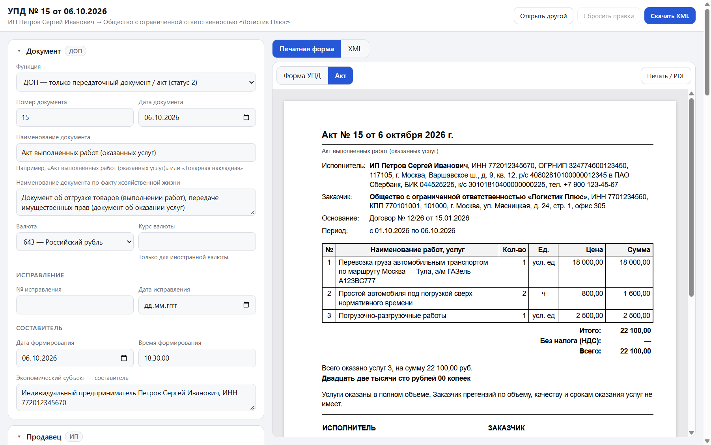

# edoview

Редактор основных реквизитов XML УПД (формат 5.03, приказ ЕД-7-26/970@) с печатной формой. Работает целиком в браузере, файл никуда не отправляется.

```bash
npm install
npm run dev     # http://localhost:5300
npm test
npm run build   # dist/ — статический сайт
```

## Скриншоты

Пример — `samples/upd-schfdop.xml` (УПД со статусом 1, НДС 22%) и `samples/act-dop.xml` (акт ИП без НДС). Оба открываются со стартовой страницы ссылками «Примеры».

**Открытие файла** — выбрать, перетащить или вставить текст XML:


**Реквизиты и печатная форма УПД** — слева редактор, справа форма, которая обновляется при каждой правке:



**Строки и пересчёт** — количество во 2-й строке изменено на 20: стоимость, НДС и итоги пересчитаны, документ помечен «изменён»:



**Итоговый XML** — можно поправить руками и применить:



**Акт ИП без НДС (ДОП)** — для функции ДОП с названием «Акт…» по умолчанию открывается форма акта:



## Что умеет

- **Загрузка**: выбрать файл, перетащить его на страницу или вставить текст XML на вкладке «Вставить XML». Кодировка (windows-1251 / UTF-8) определяется по XML-декларации.
- **Реквизиты**: функция (СЧФ / СЧФДОП / ДОП), номер и дата, наименование документа, валюта, исправление, составитель; продавец и покупатель (организация / ИП / физлицо / иностранная), адрес, банковские реквизиты; содержание операции, дата или период, документы-основания, документ об отгрузке; строки (наименование, количество, единица, цена, ставка НДС, суммы); подписанты; ИдФайл.
- **Проверки на лету**: контрольные суммы ИНН, ОГРНИП, расчётного и корр. счёта (по БИК), формат КПП, обязательные поля.
- **Пересчёт**: количество × цена → стоимость → НДС → итоги `ВсегоОпл`. Его можно выключить и править суммы вручную. Расчётные ставки (20/120 и т.п.) не пересчитываются.
- **Печатная форма**: «Форма УПД» (статус 1/2, графы 1–19, альбомный A4) или «Акт» (для ДОП). Обновляется при каждой правке, печать или PDF через «Печать / PDF».
- **XML**: вкладка с итоговым XML. Его можно поправить руками и нажать «Применить».
- **Скачивание**: файл `ИдФайл.xml` в исходной кодировке. Символы, которых нет в windows-1251, записываются как `&#x…;`.

Редактор меняет исходный DOM на месте, поэтому всё, чего нет в форме (маркировка, прослеживаемость, транспортировка, доп. сведения), остаётся в файле без изменений. Новые элементы встают на свои места по порядку из XSD.

## Структура

| Путь | Что это |
|---|---|
| `app/App.jsx` | Загрузка, рабочая область, скачивание |
| `app/editor/` | Разделы редактора (документ, участники, передача, строки, подписанты) |
| `app/lib/upd.js` | Работа с DOM УПД: поиск и создание элементов в порядке XSD, смена вида участника, строки, итоги |
| `app/lib/calc.js` | Пересчёт сумм (точная арифметика на BigInt) |
| `app/lib/xml.js` | Декодирование, разбор и сериализация XML с сохранением кодировки |
| `app/lib/render.js` | XSLT → HTML через xslt-polyfill (libxslt в WebAssembly) |
| `xslt/upd.xslt` | Печатная форма УПД |
| `xslt/act.xslt`, `xslt/common.xslt` | Форма акта и общие шаблоны (из docdriver) |
| `samples/` | Примеры: УПД СЧФДОП с НДС и акт ИП без НДС |

Из [docdriver](../docdriver) взяты XSLT акта и общие шаблоны (реквизиты, адреса, сумма прописью), загрузчик XSLT-полифила, `cp1251.js`, `decimal.js` и `requisites.js`.
