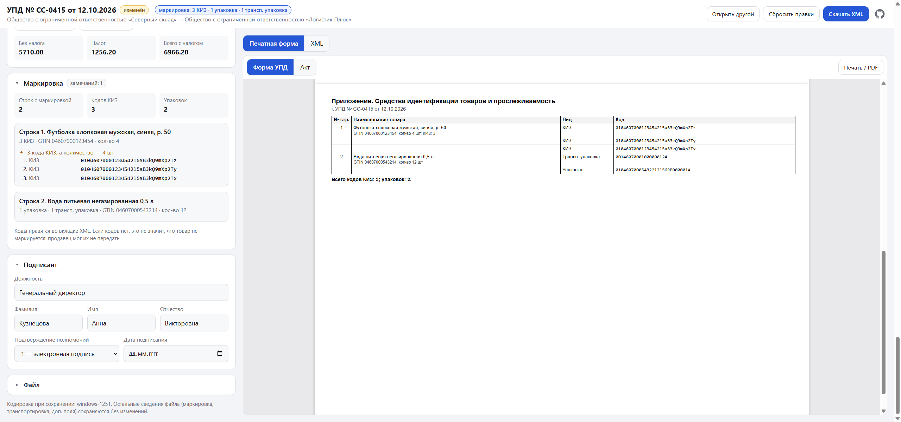

# edoview

Редактор основных реквизитов XML УПД (формат 5.03, приказ ЕД-7-26/970@) с печатной формой. Работает целиком в браузере, файл никуда не отправляется.

```bash
npm install
npm run dev     # http://localhost:5300
npm test
npm run build   # dist/ — статический сайт
```

### Docker и Coolify

Образ собирается в два этапа: `npm ci`, тесты и `vite build`, затем `dist/` раздаёт `nginx:alpine` (gzip, вечный кэш для `assets/`).

```bash
docker build -t edoview .
docker run -p 8080:80 edoview   # http://localhost:8080
```

В Coolify: Build Pack — **Dockerfile**, ветка `master`, Ports Exposes — **80**.

## Скриншоты

Примеры — `samples/upd-schfdop.xml` (УПД со статусом 1, НДС 22%), `samples/upd-marking.xml` (УПД с маркировкой) и `samples/act-dop.xml` (акт ИП без НДС). Все открываются со стартовой страницы ссылками «Примеры».

**Открытие файла** — выбрать, перетащить или вставить текст XML:


**Реквизиты и печатная форма УПД** — слева редактор, справа форма, которая обновляется при каждой правке:


**Строки и пересчёт** — количество во 2-й строке изменено на 20: стоимость, НДС и итоги пересчитаны, документ помечен «изменён»:


**Итоговый XML** — подсветка, пояснения над элементами, проверки и подсказки (здесь ИНН продавца с неверной контрольной суммой):


**Маркировка** — в строке 1 количество изменено на 4, а КИЗ три: замечание сразу появляется в разделе «Маркировка». Справа — приложение с кодами к печатной форме:



**Акт ИП без НДС (ДОП)** — для функции ДОП с названием «Акт…» по умолчанию открывается форма акта:


## Что умеет

- **Загрузка**: выбрать файл, перетащить его на страницу или вставить текст XML на вкладке «Вставить XML». Кодировка (windows-1251 / UTF-8) определяется по XML-декларации.
- **Реквизиты**: функция (СЧФ / СЧФДОП / ДОП), номер и дата, наименование документа, валюта, исправление, составитель; продавец и покупатель (организация / ИП / физлицо / иностранная), адрес, банковские реквизиты; содержание операции, дата или период, документы-основания, документ об отгрузке; строки (наименование, количество, единица, цена, ставка НДС, суммы); подписанты; ИдФайл.
- **Проверки на лету**: контрольные суммы ИНН, ОГРНИП, расчётного и корр. счёта (по БИК), формат КПП, обязательные поля.
- **Пересчёт**: количество × цена → стоимость → НДС → итоги `ВсегоОпл`. Его можно выключить и править суммы вручную. Расчётные ставки (20/120 и т.п.) не пересчитываются.
- **Печатная форма**: «Форма УПД» (статус 1/2, графы 1–19, альбомный A4) или «Акт» (для ДОП). Обновляется при каждой правке, печать или PDF через «Печать / PDF».
- **XML**: вкладка с итоговым XML в редакторе CodeMirror. Подсветка, номера строк, сворачивание элементов, поиск (Ctrl+F). Текст можно поправить руками и нажать «Применить». Редактор грузится только при открытии вкладки (~140 КБ gzip).
  - **Пояснения** над ключевыми элементами: «Продавец (графы 2–2б) · ООО … · ИНН …», «Строка 2 · …», «Всего к оплате · …». Это нередактируемый слой: в текст и в скачанный файл пояснения не попадают. Их можно скрыть галочкой.
  - **Проверки** прямо в тексте: ошибки разбора XML, контрольные суммы ИНН/ОГРНИП/счетов, формат КПП, дат и времени, обязательные атрибуты, допустимые ставки и функции, арифметика строк (количество × цена, налог по ставке, стоимость с налогом) и итогов `ВсегоОпл`. Кнопка «Замечаний: N» открывает их список.
  - **Подсказки** при наведении на тег или атрибут: что это за реквизит и в какую графу УПД он попадает.
- **Маркировка** (Честный знак и другие ГИС) определяется по `СведТов/ДопСведТов`:
  - `НомСредИдентТов` — средства идентификации: `КИЗ` (код на единицу товара), `НомУпак` (групповая упаковка), `@ИдентТрансУпак` (транспортная упаковка, SSCC), `@КолВедМарк` (весовой и разливной товар);
  - `@ГТИН` — GTIN товара; `СведПрослеж/@НомТовПрослеж` — прослеживаемость (РНПТ); `СвГосСист` — учёт в других ГИС.

  В шапке и на строках показывается значок «маркировка: 3 КИЗ · 1 упаковка». Отдельный раздел «Маркировка» содержит сводку, коды по строкам и замечания. Проверяется:
  - группа без кодов (правило XSD «хотя бы один из четырёх»);
  - повторы кодов в документе;
  - контрольные цифры GTIN и SSCC;
  - совпадение GTIN в КИЗ (`01` + GTIN + `21` + серийный номер) с `ГТИН` строки;
  - число КИЗ против количества для штучного товара (ОКЕИ 796, 715).

  Те же проверки видны в XML-редакторе, а над строками там есть пояснения про маркировку. К печатной форме добавляется приложение со всеми кодами по строкам; в графе 11 УПД печатается РНПТ. Если кодов нет, это не значит, что товар не маркируется: продавец мог их не передать.
- **Скачивание**: файл `ИдФайл.xml` в исходной кодировке. Символы, которых нет в windows-1251, записываются как `&#x…;`.

Редактор меняет исходный DOM на месте, поэтому всё, чего нет в форме (маркировка, прослеживаемость, транспортировка, доп. сведения), остаётся в файле без изменений. Новые элементы встают на свои места по порядку из XSD.

## Структура

| Путь | Что это |
|---|---|
| `app/App.jsx` | Загрузка, рабочая область, скачивание |
| `app/editor/` | Разделы редактора (документ, участники, передача, строки, подписанты) |
| `app/lib/upd.js` | Работа с DOM УПД: поиск и создание элементов в порядке XSD, смена вида участника, строки, итоги |
| `app/lib/calc.js` | Пересчёт сумм (точная арифметика на BigInt) |
| `app/lib/xml.js` | Декодирование, разбор и сериализация XML с сохранением кодировки |
| `app/xmlEditor.js` | XML-редактор на CodeMirror 6: подсветка, слой пояснений, проверки, подсказки |
| `app/lib/xmlInsight.js` | Пояснения и проверки по синтаксическому дереву lezer (без DOM, тестируется в Node) |
| `app/lib/marking.js` | Маркировка: разбор КИЗ (GS1), контрольные цифры GTIN/SSCC, проверки и сводка; адаптер DOM |
| `app/lib/checks.js`, `app/lib/glossary.js` | Проверки реквизитов (общие для формы и XML) и расшифровка элементов/атрибутов |
| `app/lib/render.js` | XSLT → HTML через xslt-polyfill (libxslt в WebAssembly) |
| `xslt/upd.xslt` | Печатная форма УПД |
| `xslt/act.xslt`, `xslt/common.xslt` | Форма акта и общие шаблоны (из docdriver) |
| `samples/` | Примеры: УПД СЧФДОП с НДС, УПД с маркировкой (КИЗ, упаковка, SSCC) и акт ИП без НДС |

Из [docdriver](../docdriver) взяты XSLT акта и общие шаблоны (реквизиты, адреса, сумма прописью), загрузчик XSLT-полифила, `cp1251.js`, `decimal.js` и `requisites.js`.
